<h1 align="center">JavaJolt</h1>

<h3 align="center">A Gamified Java Learning System</h3>

<p align="center">
  <b>OOP 101</b><br>
  Condicion, Rodhel N.<br>
  Hong, Shakeel M.<br>
  Malibiran, Mark Angelo R.
</p>

---
## Overview

JavaJolt is an interactive desktop application that seeks to guide learners in studying the fundamentals that surround Java programming through engaging lessons, quizzes, and game-inspired challenges. Putting aside traditional practices of simply reading and memorization, JavaJolt helps to boost attention spans by letting the players face programming in a gamified medium.

## Problem Description

Beginning programmers may struggle with the concepts that revolve around Java especially given its syntax and especially, its object-oriented programming concepts. This leads coders alike to fall into the same cycle of feeling repetitive without any reciprocated feedback. Learners may also find it difficult to manually monitor their progress and identify areas that needs proper emphasis. 

This is where JavaJolt comes in, by offering a game-like structure, the learners are met with such a familiar feeling. This opens up a pathway to represent structured learning materials and interactive activity which encourages continued practice.

## Project Objectives

JavaJolt aims to:

1. Provide an engaging and accessible introduction to core Java programming fundamentals.
2. Build a pathway for learners to learn through topic-based quizzes and immediate answer explanations.
3. Motivate learners with XP, levels, scores, achievements, and difficulties that can be unlocked through time.
4. Help learners in efficiently monitoring their performance by indicators that signify their experience and scores.
5. Demonstrate the practical use of object-oriented programming principles in a working Java application.

## Target Users

**Beginner Java Learners** who need a steady direction on how to actually start Java programming to properly reciprocate the courage of wanting to learn more about the vast world of coding.

**College Technology Students** who are actively involved in the learning materials of Java or OOP courses alike. JavaJolt seeks to be a certain benchmark to test their capabilities on what more they should learn and how much they already know.

**Self-directed Leaners** who choose to study on their own pace, JavaJolt also serves as an environment that values the patience and slow progress of learning. Allowing the learners to take each step on their own manner. 

**Instructors** who seek for a way to integrate a more engaging environment for students they hold concerned with Java programming. The concept within JavaJolt can be used as a reference for future materials and as well as the mediums integrated for proper engagement. 

## Main Features

| Feature | Description |
| --- | --- |
| Seven Java topics | Variables, Operators, Decisions, Loops, Arrays, Exception Handling, and Object-Oriented Programming. |
| Three difficulty levels | Beginner, Intermediate, and Advanced, with progression-based unlocking. |
| Interactive textbook | Topic-based reading materials to review concepts before taking quizzes. |
| Varied quiz questions | Multiple-choice, identification, and code-answer activities. |
| Randomized quiz selection | Quiz sessions select up to 12 questions, organized by challenge tier. |
| Quiz timer | Timed questions add challenge and encourage focused practice. |
| Battle mechanics | Players have HP and face topic-themed enemies; wrong answers can cause damage. |
| XP, score, and levels | Earn rewards, track streaks, improve personal bests, and level up. |
| Achievements and progress | Monitor completed lessons and learning milestones. |
| Power-ups | Gameplay assistance such as hints, shields, and healing. |
| Saved progress | Store player information, XP, completed topics, and high scores locally. |
| Visual and audio feedback | A mascot, enemy emotes, glow/shake reactions, and button/answer sound effects. |
| Detailed quiz results | See accuracy, performance statistics, and why an attempt did not pass. |
| Guided first-time experience | Title screen, player setup, and tutorial for new learners. |

## Technologies Used

| Technology | Purpose |
| --- | --- |
| **Java SE (JDK 21 or newer)** | Application logic and object-oriented programming. |
| **Java Swing** | Desktop interface, screens, buttons, dialogs, and interactive components. |
| **Java AWT / Java 2D** | Custom rendering, layouts, effects, and sprite animation. |
| **Java Sound API** | Playback of WAV sound effects. |
| **Java Properties and File I/O** | Local storage and retrieval of player progress. |
| **Git and GitHub** | Source control, collaboration, and project documentation. |
| **Visual Studio Code** | Development environment used by the team. |

## Team Members and Roles

| Team Member | Role / Responsibilities |
| --- | --- |
| **Rodhel N. Condicion** | Lead Artist, Documentation, Overall System Testing, Co-Developer, Lead Designer|
| **Shakeel M. Hong** | Lead Developer, Sfx and Music Integration, Graphical User-Interface Implementation, Suggestion Implementations, In-depth Polishing |
| **Mark Angelo R. Malibiran** |Project Manager, Content Implementation,User-Interface Integration, Co-Artist, Co-Developer |

## OOP Concepts 

| OOP Concept | How It Is Applied in JavaJolt |
| --- | --- |
| **Encapsulation** | The `Player` class keeps fields such as HP, XP, and score private and provides methods to update them. |
| **Abstraction** | Service classes such as `QuestionService`, `LessonRunnerService`, and `SaveService` hide implementation details behind focused methods. `Screen` is also an abstract base class for Swing screens. |
| **Inheritance** | `Screen` extends `JPanel`, and custom interface components such as `RoundedButton` extend existing Swing classes. |
| **Polymorphism** | GUI subclasses override methods such as `paintComponent()` and `setEnabled()` to customize behavior while retaining standard Swing component interfaces. |

## Instructions 

**Requirements**
1. **JDK 21 or newer** installed on your computer.
2. A computer capable of running Java desktop applications.
3. **Visual Studio Code** is optional; any terminal and a compatible JDK can be utilized

**Option A - Windows launcher (recommended)**
1. Download or clone this repository.
2. Open the project folder containing `src`, `data`, and `RUN_JAVAJOLT.bat`
3. Double-click `RUN_JAVAJOLT.bat`
4. Follow the on-screen title, welcome, or tutorial prompts to begin playing.

**Option B - Compile and run manually**
Open a terminal in the project root and run:

```cmd
javac -encoding UTF-8 -d out -sourcepath src src/edu/batstateu/javajolt/GameApplication.java
java -cp out edu.batstateu.javajolt.GameApplication
```

Run these command from the project root, since learning content and graphical assets are loaded from project-relative folders.


## Screenshots

The following screenshots showcase the actual JavaJolt
application and its main features.

### 1. Title Screen
<p align="center">
  
</p>

### 2. Welcome Screen
<p align="center">
  
</p>

### 3. Main Dashboard
<p align="center">
  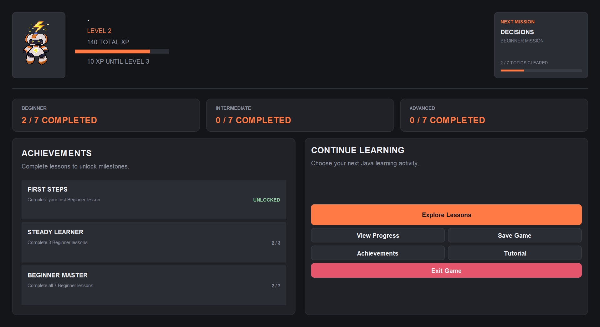
</p>

### 4. Topic Selection
<p align="center">
  
</p>

### 5. Interactive Textbook
<p align="center">
  
</p>

### 6. Quiz Gameplay
<p align="center">
  
</p>


## Character Designs

JavaJolt features eight original pixel-art characters
created by our development team using Aseprite.

Each character has three expressions: Idle, Correct,
and Hurt. These expressions provide visual feedback
during quiz battles.

### Jolty — Official JavaJolt Mascot

| Idle | Correct | Hurt |
|:---:|:---:|:---:|
|  |  |  |

Jolty is the player's companion throughout their
Java programming adventure.

### Topic Enemies

Each of the seven Java topics has its own enemy
character with three unique expressions.

#### 1. Variables

| Idle | Correct | Hurt |
|:---:|:---:|:---:|
| 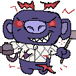 | 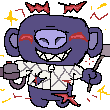 | 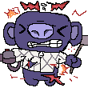 |

#### 2. Operators

| Idle | Correct | Hurt |
|:---:|:---:|:---:|
| 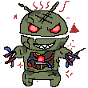 |  | 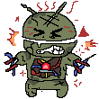 |

#### 3. Decisions

| Idle | Correct | Hurt |
|:---:|:---:|:---:|
| 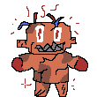 |  |  |

#### 4. Loops

| Idle | Correct | Hurt |
|:---:|:---:|:---:|
|  |  |  |

#### 5. Arrays

| Idle | Correct | Hurt |
|:---:|:---:|:---:|
| 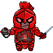 |  | 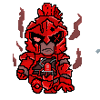 |

#### 6. Exception Handling

| Idle | Correct | Hurt |
|:---:|:---:|:---:|
| 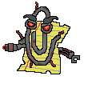 |  | 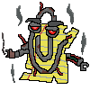 |

#### 7. Object-Oriented Programming

| Idle | Correct | Hurt |
|:---:|:---:|:---:|
| 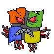 |  | 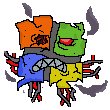 |

### Character Reactions During Gameplay

- **Correct answer:** Jolty shows its Correct expression,
  while the enemy displays Hurt.
- **Incorrect answer:** Jolty displays Hurt,
  while the enemy shows Correct.
- **Normal gameplay:** Both characters display
  their Idle expressions.

The character animations also include glow and shake
effects to make quiz battles more engaging.

All original editable Aseprite files are available
in the `art-source/characters/` directory.


## Limitations

1. JavaJolt remains a desktop application; implying no existence of a web or mobile version. 
2. The included one-click launcher is designed solely for **Windows**. Other systems require manual Java commands or a separate launcher.
3. The game is primarily configured to be **single-player and offline**; progress is stored on the user's device rather than synchronized via online account. 
4. Lesson materials are packaged within the project which implies that new content would require a full project update. 
5. Some visual emotess are configured via sprites or image variations rather than fully animated characters.
6. The project comes around as an educational prototype and may require further accessibility, corss-platform, and user-experience testing.

## Future Improvements

1. Expand the question bank with new coding exercises and topics. 
2. Improve accessibility, keyboard navigation, and more freedom for audio settings.
3. Explore optional cloud saves, user profiles, and additional learning challenges. 

## Contributors

JavaJolt was developed as a collaborative OOP 101 project by:

**Rodhel N. Condicion**,
**Shakeel M. Hong**,
**Mark Angelo R. Malibiran**,

---

### Team-drawn character sprites

The mascot and seven topic enemies now use the team's own Aseprite art in
**Idle**, **Correct**, and **Hurt** variants. Character portrait rendering,
flash colors, and shake timing are shared across the UI; all original
editable files are included. See [Character Art Integration](CHARACTER_ART_INTEGRATION.md)
and the [sprite preview](art-source/CHARACTER_VARIANTS_PREVIEW.png).
