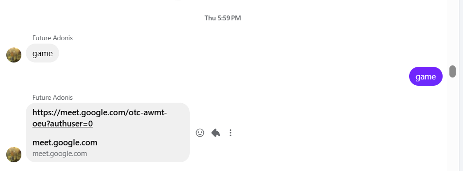
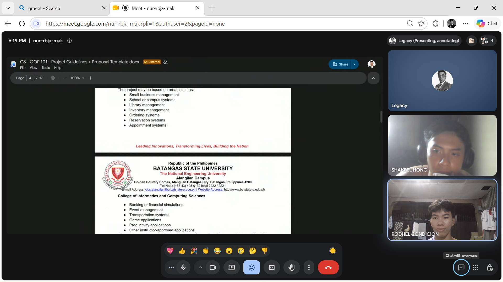
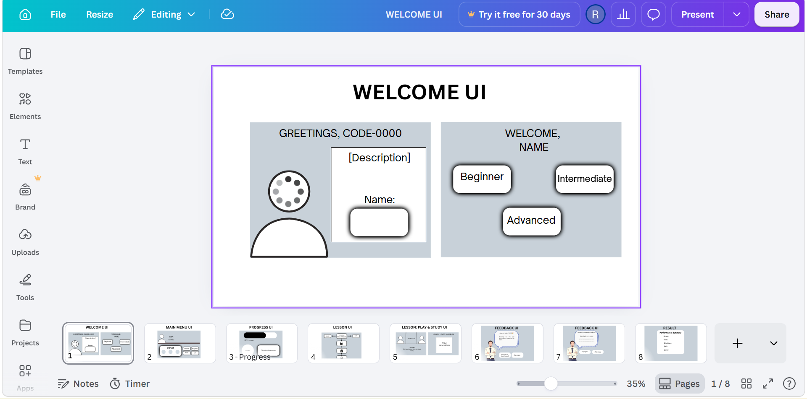
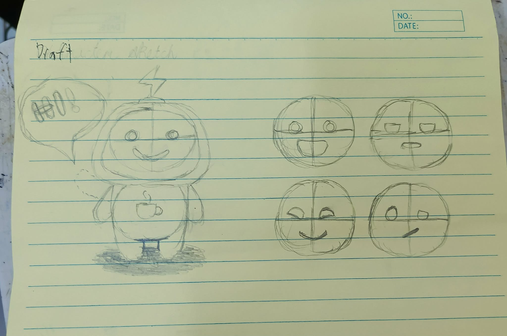
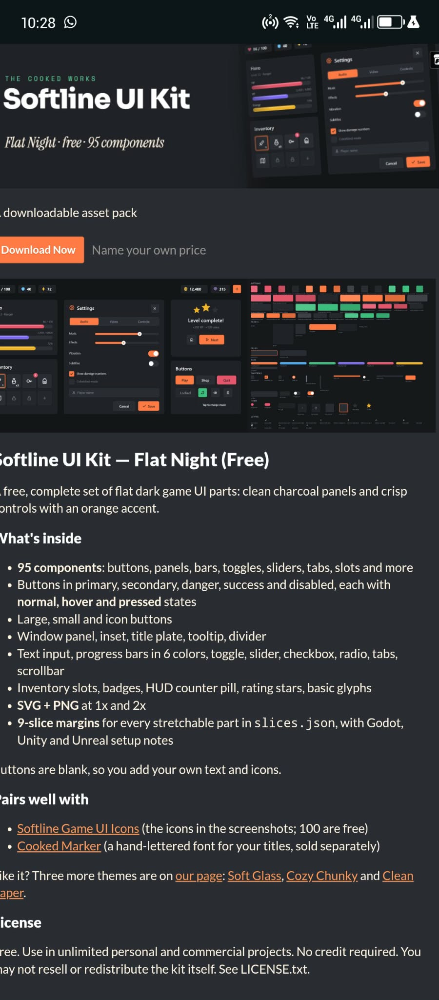
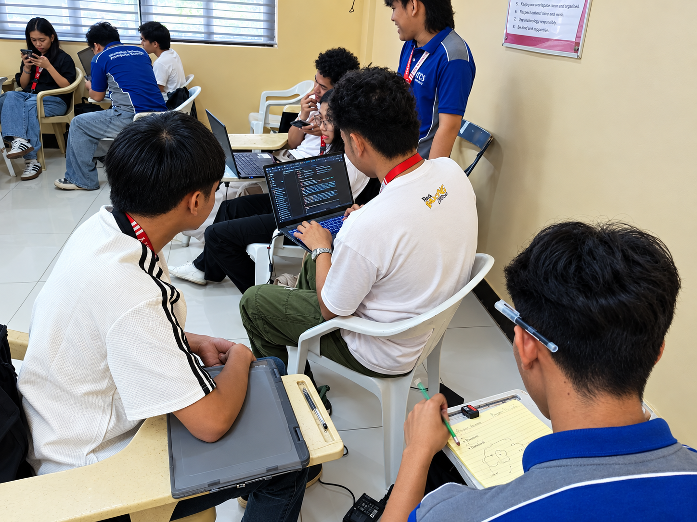
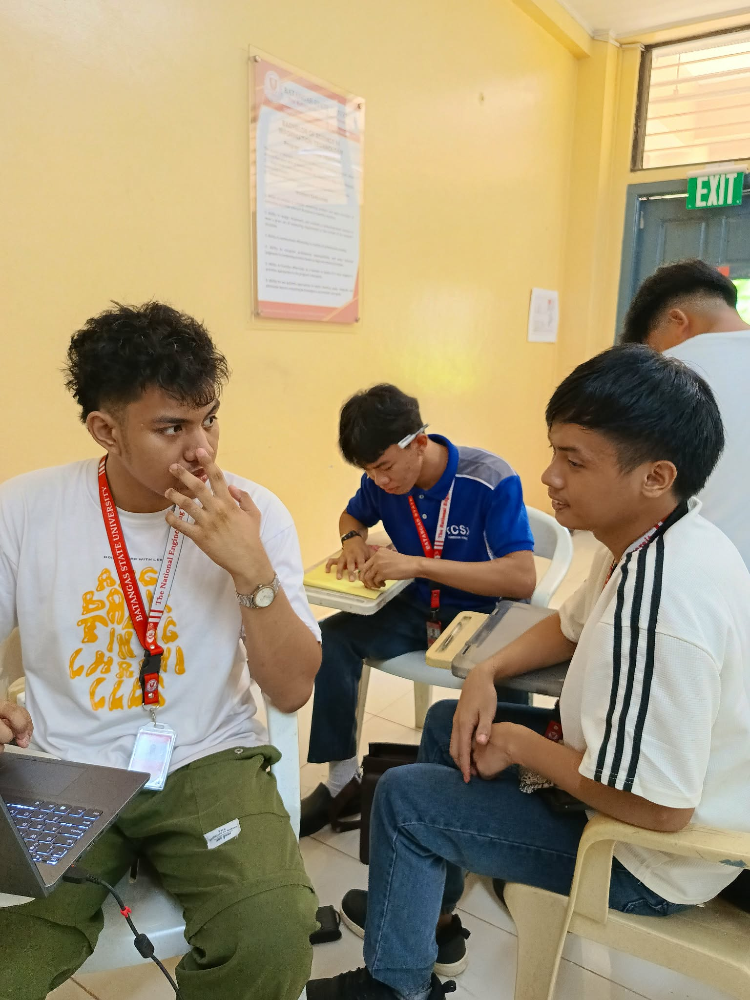
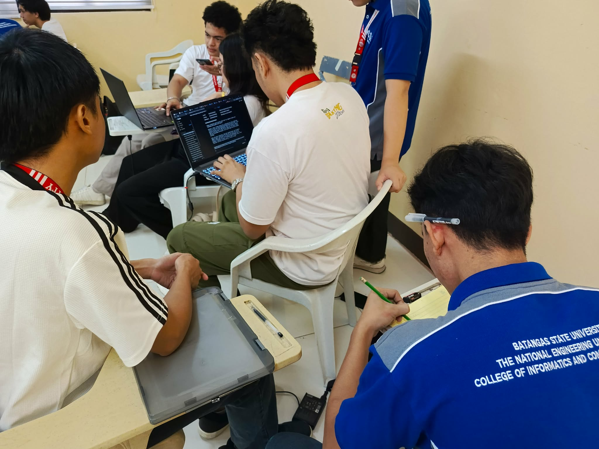

# PROGRESS DOCUMENTATION 
 
## October 1, 2026 ✅ 
 
- Conducted an online meeting following the agenda (6:00 PM): 
  - Planned the creation of the GitHub repository 
  - Exchanged ideas 
  - Finalized the project idea 
  - Discussed the workflow of the game/system 
  - Assigned parts to each group member 
 
   
 
- Completed the project paper template 
 
- Started developing the system's skeleton 
 
- Created the timetable 
 
- Started suggesting names for the game 
 
 
## October 2, 2026 ✅ 
 
- Conducted an online meeting following the agenda (6:00 PM): 
  - Created the GitHub repository 
  - Defined Plan B and Plan C 
  - Discussed how the game will encourage learners to play it 
  - Finalized the level system of the game 
  - Discussed and planned when to execute and implement the GUI 
  - Discussed terminal design for better UI 
  - Discussed the integration of software tools to prevent starting from scratch 
 
- Continued creating the skeleton of the game 
 
   
 
   
 
 
## October 5, 2026 ✅ 
 
- Completed the remaining sections of the project proposal 
 
- Successfully received approval for the project proposal 
 
- Created the initial GUI draft 
 
   
 
 
## October 6, 2026 ✅ 
 
- Defined the project roadmap 
 
- Created the learner in-game character sketch 
 
   
 
- Researched suitable themed game assets on itch.io 
 
   
 
- Organized the game file structure 
 
- Team in Action Moments 
 
   
 
   
 
   
 
 
## October 7, 2026 ✅ 
 
- Started digesting the different parts of the system 
 
 
## October 8, 2026 ✅ 
 
- Started disseminating the different parts of the system
